# MicroClear — AI-Based Microplastic Pollution Risk Assessment and Mitigation System

MicroClear is an AI-based water assessment system that detects microplastic particles in microscope images and evaluates water pollution risk using water-quality parameters.

The system combines **YOLOv8 object detection, Random Forest classification, and rule-based safety checks** to generate a final risk assessment and provide treatment recommendations through a Streamlit web application.

## Table of Contents

- [Project Overview](#1-project-overview)
- [Problem Statement](#2-problem-statement)
- [Main Objectives](#3-main-objectives)
- [System Architecture](#4-system-architecture)
- [System Workflow](#5-system-workflow)
- [Application Screenshots](#6-application-screenshots)
- [AI Models](#7-ai-models)
- [Final Risk Decision](#8-final-risk-decision)
- [Model Performance](#9-model-performance)
- [Technology Stack](#10-technology-stack)
- [Installation](#11-installation)
- [Run the Application](#12-run-the-application)
- [How to Use](#13-how-to-use)
- [Expected Output](#14-expected-output)

## 1. Project Overview

MicroClear provides an automated approach to screening water samples for potential microplastic pollution and assessing water-quality risks.

The system uses three main components:

- **YOLOv8:** Detects and counts microplastic particles in microscope images.
- **Random Forest:** Classifies water pollution risk using the detected particle count and water-quality parameters.
- **Rule-Based Safety Layer:** Checks critical water-quality conditions and can increase the final risk level when a parameter falls into the defined Poor category.

The application provides risk assessments, model confidence, parameter classifications, and treatment recommendations.

## 2. Problem Statement

Microplastic pollution is difficult to identify and assess through manual inspection alone. Laboratory techniques can require specialized equipment, trained personnel, and additional resources.

MicroClear offers an accessible, AI-assisted screening approach. It analyzes microscope images, combines the detected microplastic count with pH, Total Dissolved Solids (TDS), and turbidity measurements, and generates a preliminary pollution risk assessment.

**Important:** MicroClear is a screening and decision-support tool. Its predictions do not replace laboratory microplastic identification, certified water-quality testing, or official drinking-water safety assessments.

## 3. Main Objectives

- Detect microplastic particles in microscope images.
- Automatically count detected particles and display bounding boxes.
- Calculate detection confidence using YOLOv8.
- Collect pH, TDS, and turbidity measurements.
- Classify water pollution risk using a Random Forest model.
- Apply rule-based safety checks to determine the final risk level.
- Present results through a user-friendly Streamlit application.
- Provide risk-based treatment recommendations and a detailed assessment report.

## 4. System Architecture

The MicroClear architecture connects image processing, object detection, water-quality inputs, machine learning, and rule-based safety checks.

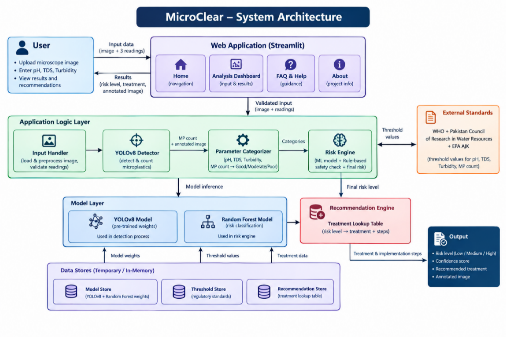

<p align="center">Figure 5.1: High-level architecture of MicroClear</p>

## 5. System Workflow

The system follows this analysis pipeline:

```text
Microscope Image
       |
       v
Image Preprocessing
       |
       v
YOLOv8 Microplastic Detection
       |
       v
Detected Particles, Count, and Confidence
       |
       +-----------------------------+
       |                             |
       v                             v
pH, TDS, and Turbidity         Microplastic Count
       |                             |
       +--------------+--------------+
                      |
                      v
             Random Forest Model
                      |
                      v
              ML Risk Prediction
                      |
                      v
            Rule-Based Safety Layer
                      |
                      v
                Final Risk Level
                      |
                      v
        Assessment and Recommendations
```

The final risk level belongs to one of three categories:

- **Low**
- **Medium**
- **High**

## 6. Application Screenshots

The following screenshots demonstrate the main application pages and analysis features.

### 6.1 Home Page

The home page introduces MicroClear and provides access to the water sample assessment workflow.

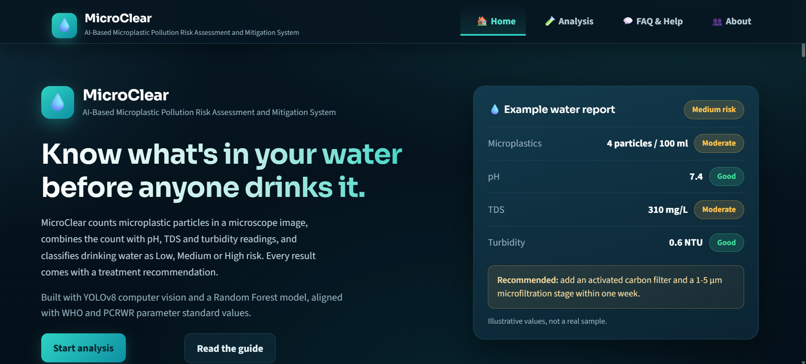

<p align="center">Figure 6.2: Home page</p>

### 6.2 Analysis Dashboard

The Analysis Dashboard allows users to upload a microscope image, enter water-quality measurements, and initiate an assessment.

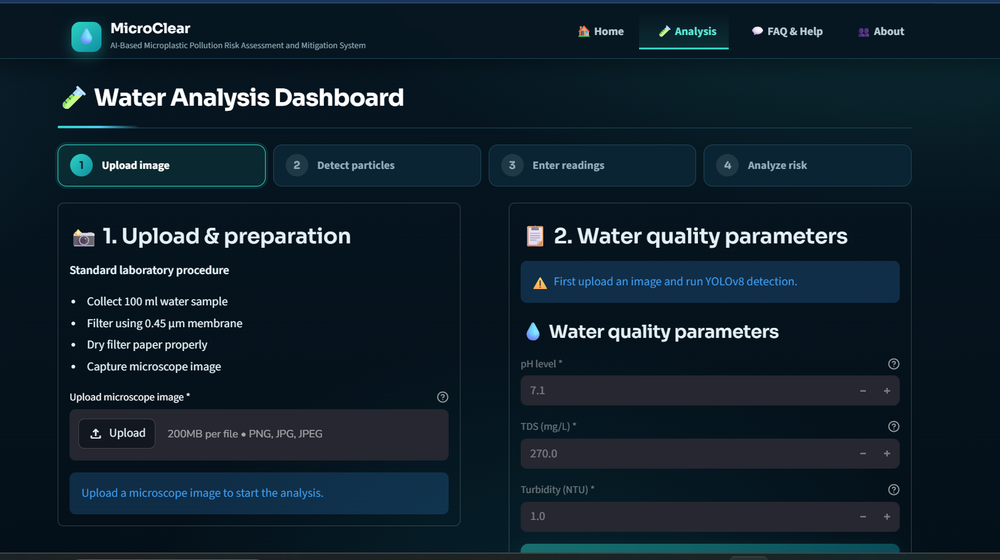

<p align="center">Figure 6.3: Analysis Dashboard</p>

### 6.3 Risk Assessment

The Risk Assessment tab displays the final risk level, machine learning prediction, confidence information, and relevant assessment details.

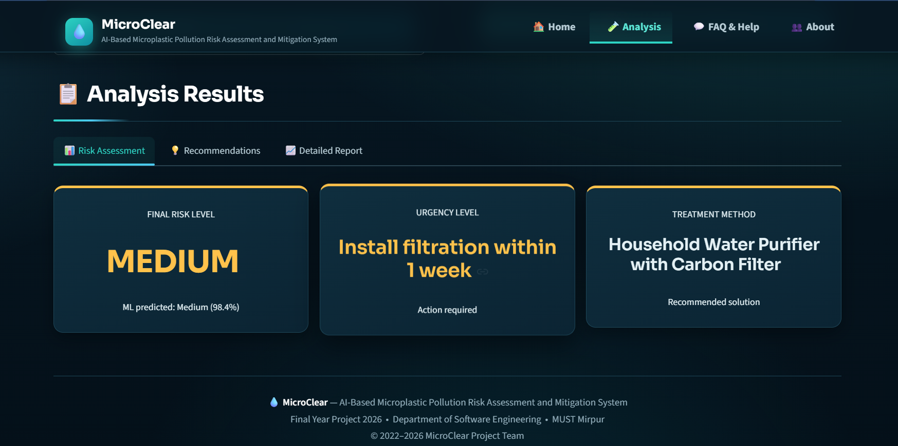

<p align="center">Figure 6.4: Results Screen (Risk Assessment tab)</p>

### 6.4 Treatment Recommendations

The Recommendations tab provides treatment suggestions and actions according to the assessed risk level.

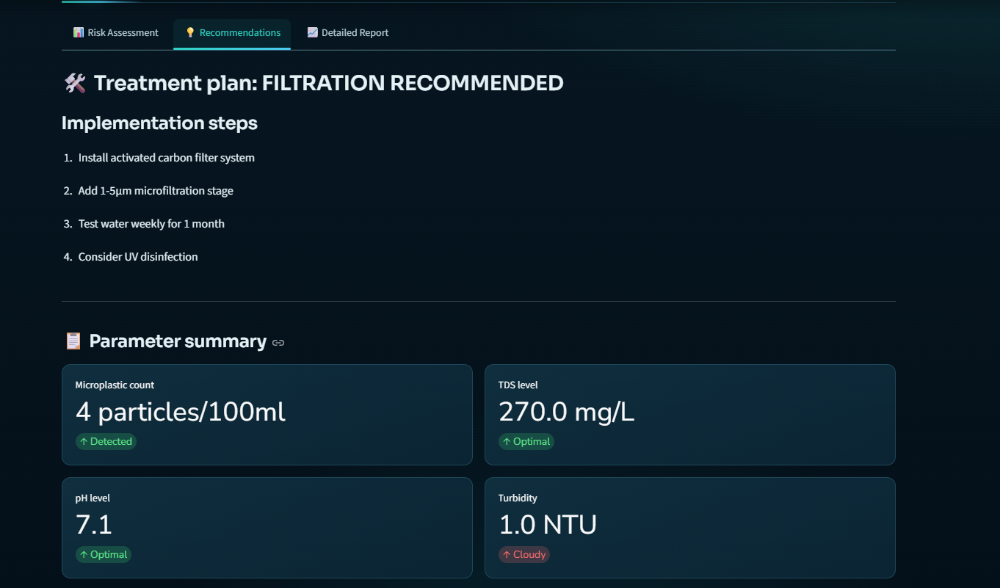

<p align="center">Figure 6.5: Results Screen (Recommendations tab)</p>

### 6.5 Detailed Assessment Report

The Detailed Report presents additional information about the prediction, detected particles, water-quality measurements, and safety checks.

**Report overview:**

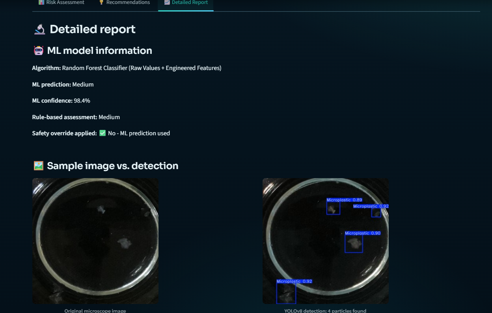

<p align="center">Figure 6.6: Results Screen (Detailed Report tab, top half)</p>

**Additional report details:**

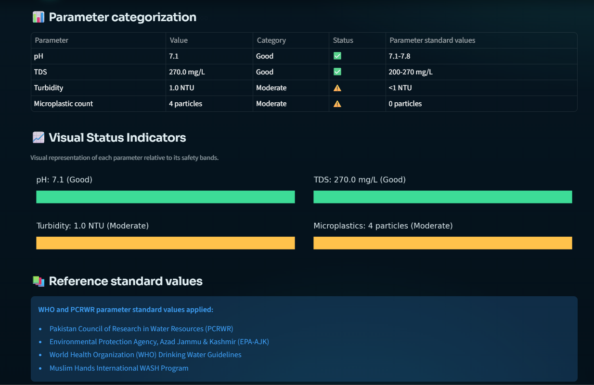

<p align="center">Figure 6.7: Results Screen (Detailed Report tab, bottom half)</p>

### 6.6 FAQ and Help

The FAQ and Help page provides information to help users understand and use the system.

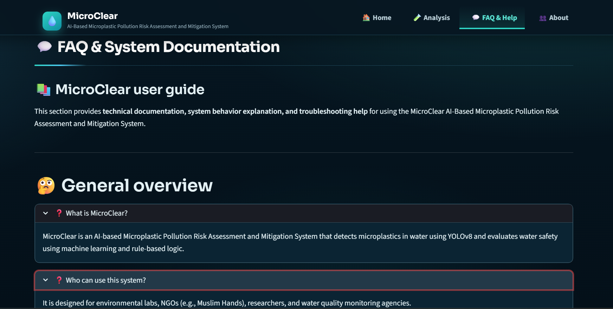

<p align="center">Figure 6.8: Frequently Asked Questions and Help page</p>

### 6.7 About Page

The About page presents information about the MicroClear project.

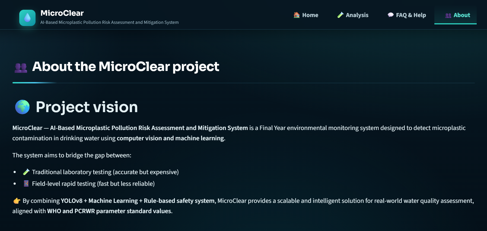

<p align="center">Figure 6.9: About page</p>

### 6.8 Safety Override

The safety layer can override the initial machine learning prediction when a measured water-quality parameter falls into the system's defined Poor category.

This feature adds an additional rule-based check before the final risk level is displayed.

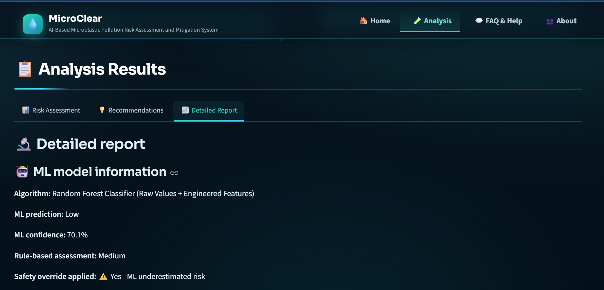

<p align="center">Figure 7.1: Results Screen showing a safety override</p>

## 7. AI Models

### 7.1 YOLOv8 — Microplastic Detection

MicroClear uses YOLOv8 for object detection in microscope images.

The model:

- Detects microplastic particles.
- Draws bounding boxes around detected objects.
- Counts the detected particles.
- Provides confidence scores for detections.

**Detection configuration:**

| Setting | Value |
|---|---|
| Model | YOLOv8 |
| Input image size | 640 × 640 |
| Detection confidence threshold | 0.50 |
| Training duration | 100 epochs |

### 7.2 Random Forest — Risk Classification

The Random Forest classifier predicts a water pollution risk category using the following features:

- pH
- Total Dissolved Solids (TDS)
- Turbidity
- Detected microplastic count

The model produces one of three risk classes:

```text
Low
Medium
High
```

The model prediction is subsequently checked by the rule-based safety layer.

## 8. Final Risk Decision

MicroClear combines machine learning with rule-based safety logic.

1. YOLOv8 detects and counts microplastic particles.
2. The system combines the detected count with the entered water-quality parameters.
3. The Random Forest model predicts the initial pollution risk.
4. The safety layer checks the parameter classifications.
5. If any parameter falls into the defined Poor category, the final risk is raised to High.

The system retains the initial machine learning prediction for comparison with the final risk assessment.

This approach adds an explicit safety check rather than relying exclusively on the classifier output.

## 9. Model Performance

The following results summarize the reported model evaluation metrics.

### 9.1 YOLOv8 Validation Results

| Metric | Result |
|---|---:|
| Precision | 94.87% |
| Recall | 89.04% |
| F1-Score | 91.86% |
| mAP@50 | 93.38% |
| mAP@50–95 | 66.67% |

The reported validation precision exceeded the project's 85% precision target.

### 9.2 YOLOv8 Test Results

| Metric | Result |
|---|---:|
| Precision | 96.70% |
| Recall | 91.26% |
| F1-Score | 93.90% |
| mAP@50 | 95.32% |
| mAP@50–95 | 68.82% |

### 9.3 YOLOv8 Training and Validation Loss Curves

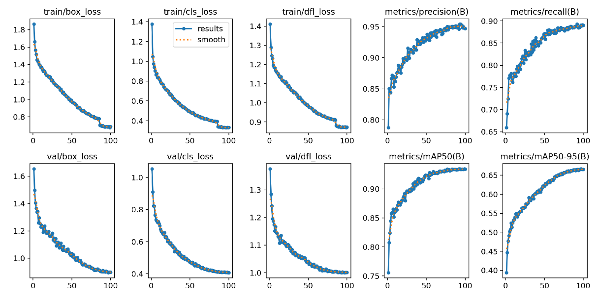

<p align="center">Figure 7.3: YOLOv8 training and validation loss curves over 100 epochs</p>

### 9.4 YOLOv8 Confusion Matrix

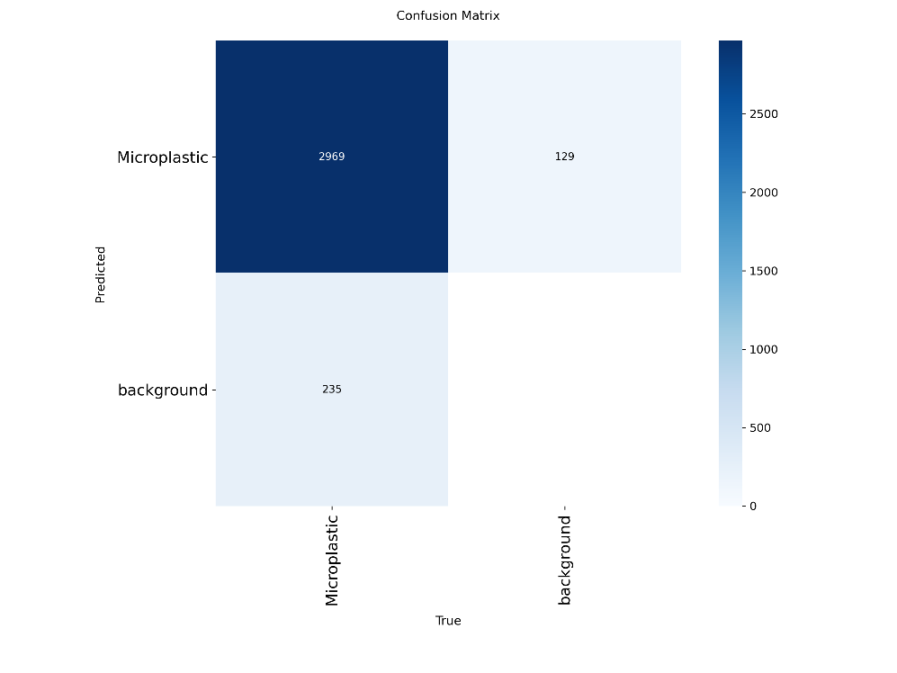

<p align="center">Figure 7.4: YOLOv8 confusion matrix on the held-out test set</p>

### 9.5 Random Forest Confusion Matrix

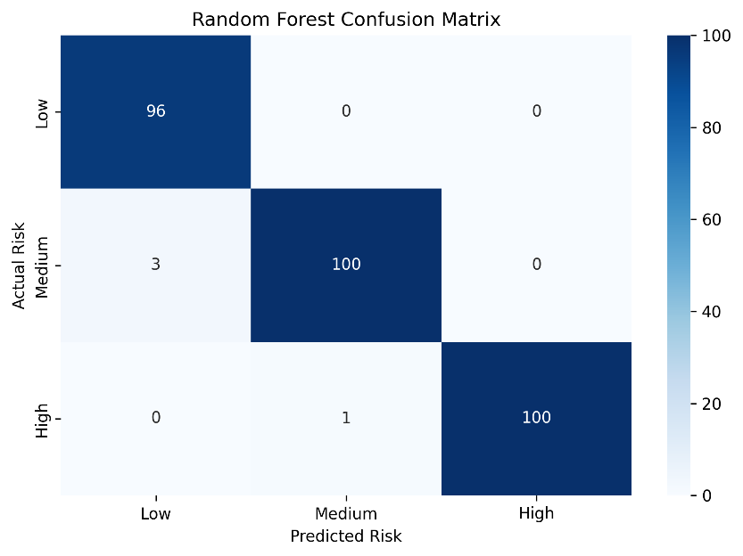

<p align="center">Figure 7.5: Random Forest confusion matrix on the held-out test set</p>


## 10. Technology Stack

| Category | Technologies |
|---|---|
| Programming Language | Python |
| Web Interface | Streamlit |
| Object Detection | YOLOv8, Ultralytics |
| Machine Learning | Random Forest, Scikit-learn |
| Data Processing | NumPy, Pandas |
| Image Processing | OpenCV, Pillow |
| Model Serialization | Joblib |
| Visualization | Matplotlib, Seaborn |

## 11. Installation

### Prerequisites

- Python installed on your computer.
- Git installed on your computer.
- The MicroClear source code repository.
- The trained model files required by the application.

### Step 1: Clone the Repository

```bash
git clone https://github.com/Engr-Usman-Ali/Final-Year-Project.git
```

### Step 2: Open the Project Directory

```bash
cd Final-Year-Project
```

### Step 3: Create a Virtual Environment

**Windows PowerShell:**

```powershell
python -m venv .venv
```

Activate it:

```powershell
.\.venv\Scripts\Activate.ps1
```

If PowerShell blocks activation, you can run the environment's Python executable directly instead.

### Step 4: Install Dependencies

```bash
python -m pip install -r requirements.txt
```

## 12. Run the Application

Start the Streamlit application:

```bash
streamlit run app.py
```

Streamlit will provide a local URL in the terminal. Open that URL in your browser to access MicroClear.

## 13. How to Use

### Step 1: Upload a Microscope Image

Upload a supported microscope image of the water sample.

### Step 2: Detect Microplastics

Run the detection process. YOLOv8 identifies particles and displays the detection results, including bounding boxes, particle count, and confidence scores.

### Step 3: Enter Water-Quality Parameters

Enter the measured values for:

- pH
- TDS
- Turbidity

The microplastic count is obtained automatically from the detection process.

### Step 4: Analyze the Sample

Run the risk assessment. The system combines the detected microplastic count and water-quality measurements to generate a machine learning prediction.

### Step 5: Review the Results

Review the final risk level, parameter classifications, model confidence, safety override status, and treatment recommendations.

### Step 6: Review the Detailed Report

Open the Detailed Report tab to examine the assessment information and supporting results.

## 14. Expected Output

MicroClear provides the following outputs after a successful assessment.

### Risk Assessment

- Final pollution risk level.
- Initial machine learning prediction.
- Model confidence.
- Safety override status.

### Water-Quality Summary

- Measured pH.
- TDS value in mg/L.
- Turbidity in NTU.
- Detected microplastic count.
- Parameter classifications.

### Recommendations

- Suggested treatment approach.
- Urgency information.
- Recommended actions.
- Treatment implementation steps.

### Detailed Report

The detailed report combines the model prediction, detection results, water-quality measurements, parameter classifications, and final safety decision.

